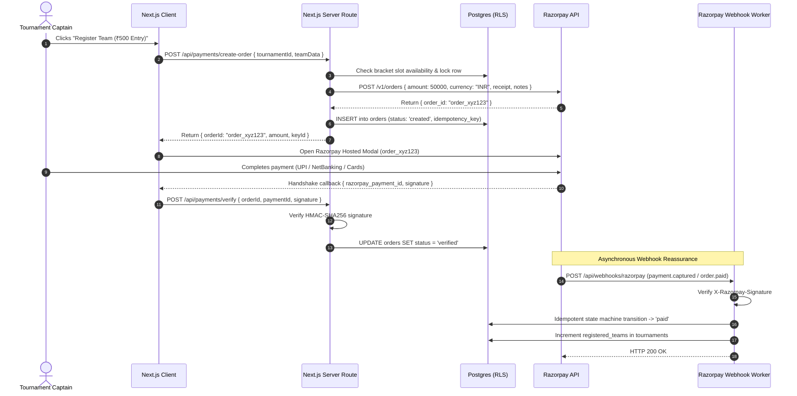

# UGG Phase 6: Finance & Payments Architecture Design Document

**Document Version:** 1.0.0  
**Target Gateway:** Razorpay Hosted Checkout (Standard / Custom Pages)  
**Status:** Architecture Blueprint (Design Documentation Only — No Implementation)  
**Applicability:** Paid tournament entry fees, campus scrim passes, merch pre-orders  

---

## 1. Executive Summary & Design Principles

To future-proof the UGG platform for paid tournament registrations and prize pool handling, this design establishes a banking-grade, PCI-DSS compliant checkout architecture. 

### Core Security & Privacy Principles
1. **Zero Card/Bank Data Storage**: No credit card, debit card, UPI PIN, or bank credentials ever touch UGG application servers or databases. All sensitive payment entry occurs inside Razorpay’s PCI-DSS Level 1 certified hosted checkout elements.
2. **Server-Side Order Authorisation**: All payment amounts and currency definitions are calculated exclusively on trusted server runtimes. Clients cannot specify prices or manipulate fee structures.
3. **Cryptographic Webhook Verification**: State transitions rely strictly on HMAC-SHA256 signature verification over incoming Razorpay webhook payloads.
4. **Idempotency Across Handshakes**: Every checkout session and webhook delivery uses idempotency keys to eliminate double-charges, replay attacks, and duplicate registrations.
5. **Least-Privilege Database Access**: Payment and order records are restricted via Postgres Row Level Security (RLS) so that public visitors can never query user transaction histories.

---

## 2. End-to-End Payment Flow & Architecture



---

## 3. Database Schema & State Machine

### 3.1 Relational Schema

```sql
-- 1. Orders Table: Tracks checkout intents and registration payloads
create table if not exists public.orders (
  id uuid primary key default gen_random_uuid(),
  tournament_id text not null references public.tournaments(id) on delete restrict,
  user_id uuid not null references auth.users(id) on delete restrict,
  razorpay_order_id text unique not null,
  amount_in_cents bigint not null, -- Store INR in paise (₹500.00 = 50000)
  currency text not null default 'INR',
  status text not null default 'created' 
    check (status in ('created', 'attempted', 'paid', 'failed', 'refunded', 'disputed')),
  team_name text not null,
  captain_email text not null,
  captain_phone text not null,
  team_roster jsonb default '[]'::jsonb,
  idempotency_key text unique not null,
  created_at timestamptz default now() not null,
  updated_at timestamptz default now() not null
);

-- 2. Payments Table: Immutable ledger of gateway transaction records
create table if not exists public.payments (
  id uuid primary key default gen_random_uuid(),
  order_id uuid not null references public.orders(id) on delete restrict,
  razorpay_payment_id text unique not null,
  amount_in_cents bigint not null,
  currency text not null default 'INR',
  method text not null, -- 'upi', 'card', 'netbanking'
  status text not null check (status in ('authorized', 'captured', 'refunded', 'failed')),
  gateway_fee_cents bigint default 0,
  gateway_tax_cents bigint default 0,
  error_code text,
  error_description text,
  webhook_event_id text unique,
  raw_payload jsonb not null default '{}'::jsonb,
  created_at timestamptz default now() not null
);

-- 3. Refunds Table: Audit trail for prize returns and dispute handling
create table if not exists public.refunds (
  id uuid primary key default gen_random_uuid(),
  payment_id uuid not null references public.payments(id) on delete restrict,
  razorpay_refund_id text unique not null,
  amount_in_cents bigint not null,
  reason text not null,
  status text not null check (status in ('pending', 'processed', 'failed')),
  initiated_by text not null, -- Admin UUID
  created_at timestamptz default now() not null
);
```

### 3.2 Status State Machine
- `created`: Server established an order on Razorpay; customer is shown the modal.
- `attempted`: Player initiated a transaction in the gateway interface.
- `paid`: Payment captured successfully via verified webhook or synchronous signature check.
- `failed`: Transaction aborted, cancelled, or declined by issuing bank.
- `refunded`: Funds returned to payer (e.g., tournament canceled or team disqualified prior to bracket draw).
- `disputed`: Payer raised a chargeback with bank; team status suspended pending evidence submission.

---

## 4. Idempotency & Webhook Verification

### 4.1 Idempotency Key Handling
1. Every order creation request from the client includes a client-generated UUID `idempotency_key`.
2. The server creates the order in a database transaction. If the same `idempotency_key` is submitted within 12 hours, the existing order is returned without contacting Razorpay again.
3. Every Razorpay webhook payload contains `x-razorpay-event-id`. Storing this identifier in `payments.webhook_event_id` with a `unique` constraint guarantees that duplicate webhook deliveries are acknowledged with 200 OK without re-triggering slot allocation.

### 4.2 Webhook Signature Verification Algorithm
```typescript
import crypto from "node:crypto";

export function verifyRazorpaySignature(
  rawBody: string,
  receivedSignature: string,
  webhookSecret: string
): boolean {
  const expectedSignature = crypto
    .createHmac("sha256", webhookSecret)
    .update(rawBody)
    .digest("hex");

  // Constant-time string comparison to prevent timing attacks
  return crypto.timingSafeEqual(
    Buffer.from(receivedSignature, "utf8"),
    Buffer.from(expectedSignature, "utf8")
  );
}
```

---

## 5. Security & PII Minimization

1. **PII Collection Limits**:
   - Collect only: Team Name, Captain Name, In-Game ID, WhatsApp / Phone number (for scrim coordination), and Email (for receipts).
   - Do NOT collect: Residential addresses, Aadhaar/PAN, date of birth, or banking credentials.
2. **Postgres RLS Policies**:
   - `orders`: Authenticated players can only `SELECT` their own orders (`auth.uid() = user_id`).
   - `payments`: Readable only by administrators (`app_metadata.role = 'admin'`).
   - Public visitors have zero access to financial records.
3. **Database Role Privileges**:
   - Webhook application role has `INSERT` and `UPDATE` on orders and payments, but no `DROP` or `TRUNCATE`.

---

## 6. Refunds & Dispute Resolution Flow

1. **Tournament Cancellation**:
   - In the event of event postponement or cancellation, the admin portal triggers `POST /v1/payments/{payment_id}/refund` via Razorpay's API.
   - Razorpay reverses funds directly to the source account (UPI / card) within 5–7 banking days.
2. **Dispute / Chargeback Protocol**:
   - If a chargeback event `payment.dispute.created` is received, the team registration is immediately flagged as `disputed`.
   - Admin is notified with evidence requirements (registration logs, bracket match logs, rules consent).
   - Once resolved, the status transitions to either `paid` (dispute won) or `refunded` (dispute lost).

---

## 7. Production Go-Live Checklist

- [ ] **HTTPS Enforced**: HSTS header with `max-age=63072000; includeSubDomains; preload` active.
- [ ] **Key Segregation**: Test keys (`rzp_test_*`) swapped for restricted Live keys (`rzp_live_*`).
- [ ] **Secrets Management**: `RAZORPAY_KEY_SECRET` and `RAZORPAY_WEBHOOK_SECRET` stored strictly in Vercel Encrypted Environment Variables (never in git or client code).
- [ ] **Webhook Target Configured**: Razorpay dashboard configured to send `payment.captured`, `payment.failed`, `refund.processed`, and `order.paid` to `https://ugg.gg/api/webhooks/razorpay`.
- [ ] **Database Backups**: Point-in-time recovery (PITR) enabled on Supabase Postgres.
- [ ] **Log Scrubbing**: Log drains configured to ensure transaction IDs and error codes are recorded, but customer phone numbers, emails, and names are masked.
